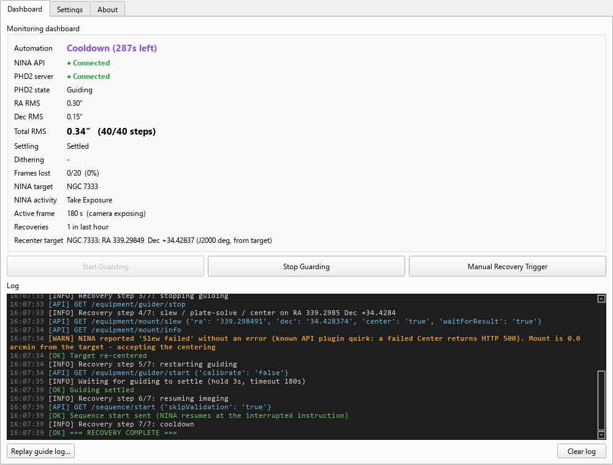
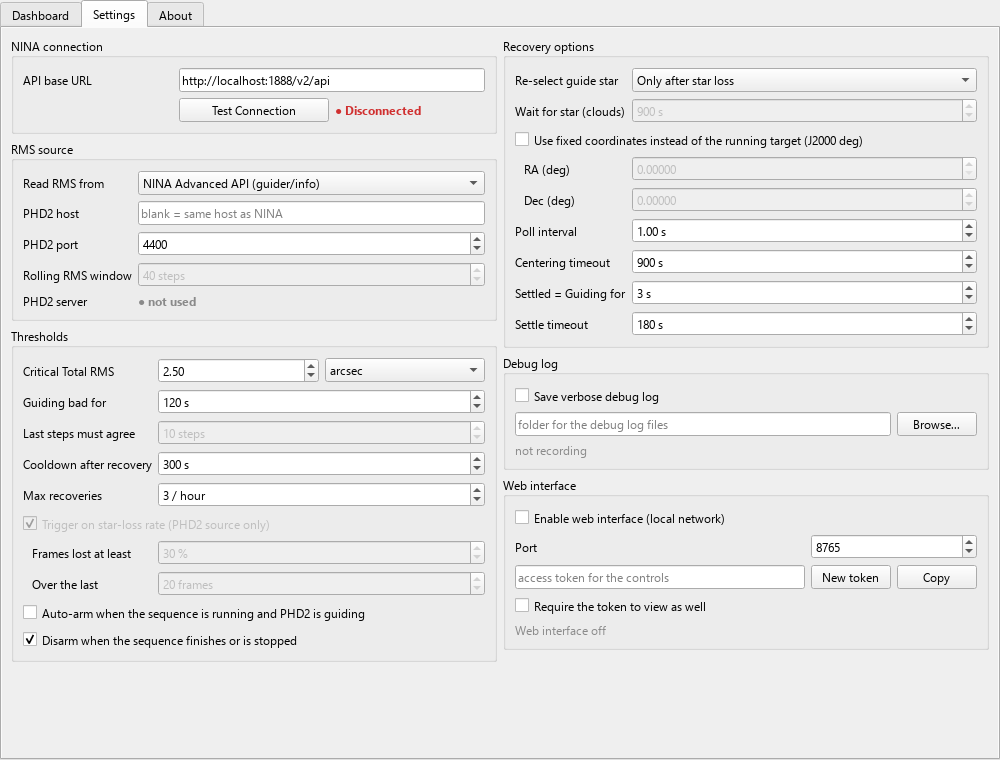
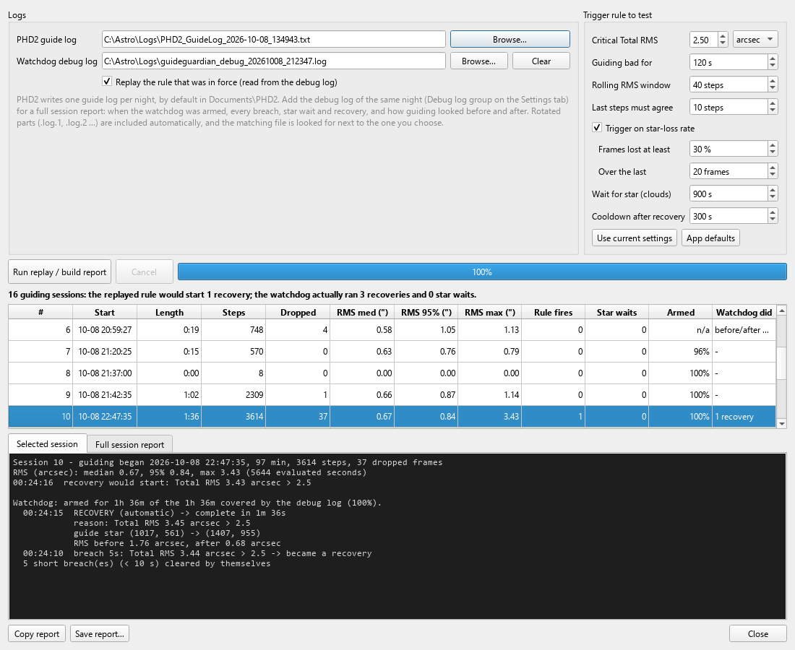
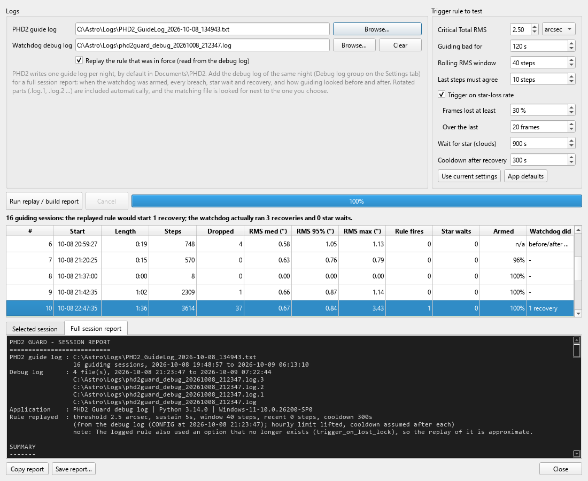
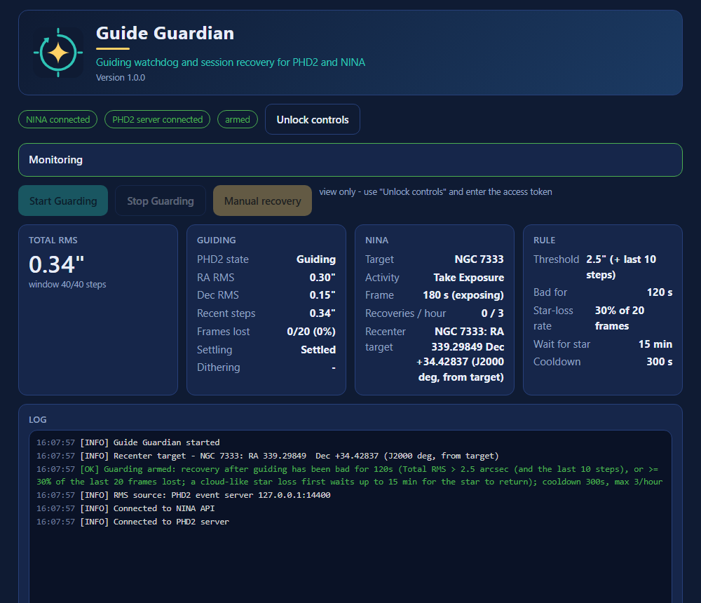
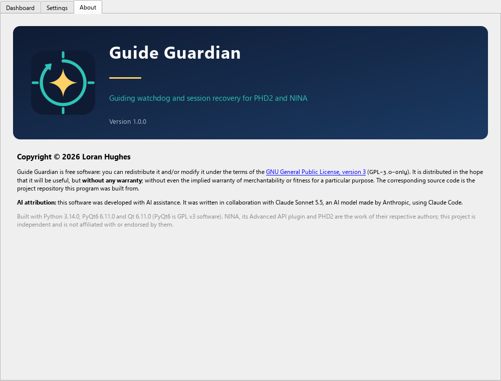

# PHD2 Guard

A guiding watchdog for astrophotography rigs that use **NINA** and **PHD2**. It watches the quality of your guiding while a NINA
sequence runs and, when guiding has genuinely failed, stops the exposure, re-centers the target, restarts guiding and
resumes the sequence, without waiting for you to notice.

It is a Windows desktop application (PyQt6) with an optional local-network web interface for monitoring and control from
another computer, tablet or phone.

**[Download the latest release](https://github.com/WestwoodAstro/PHD2Guard/releases/latest)**: a single `PHD2Guard.exe`, nothing to install. Windows 10/11, 64-bit.

> **Use at your own risk.** PHD2 Guard stops and restarts your sequence, slews your mount and restarts guiding. Try it with the
> NINA and PHD2 simulators before relying on it unattended, and keep NINA's own safety monitor / end-of-sequence steps for
> parking and closing up. This project is not affiliated with NINA or PHD2.

## Contents

- [Features](#features)
- [Screenshots](#screenshots)
- [Requirements](#requirements)
- [Installation](#installation)
- [Quick start](#quick-start)
- [How it decides to act](#how-it-decides-to-act)
- [What a recovery does](#what-a-recovery-does)
- [Settings reference](#settings-reference)
- [RMS source: NINA or PHD2](#rms-source-nina-or-phd2)
- [Web interface and headless mode](#web-interface-and-headless-mode)
- [Diagnostics](#diagnostics)
- [NINA API endpoints used](#nina-api-endpoints-used)
- [Behavior notes](#behavior-notes)
- [Project layout](#project-layout)
- [License](#license)
- [AI attribution](#ai-attribution)

## Features

- **Live dashboard:** guiding state, RA / Dec / Total RMS, recent-step RMS, frames lost, dither / settling indicators, current
  NINA target, activity and exposure, recoveries this hour.
- **Automatic recovery:** stop sequence and exposure, stop guiding, slew + plate-solve + center on the *running* target,
  optionally pick a different guide star, restart guiding, resume the sequence at the interrupted instruction.
- **Cloud-aware:** a star lost to thin cloud is waited out instead of triggering a pointless recovery.
- **Fails safe:** a failed recovery is rolled back (mount, guiding, sequence) and retried with back-off before the automation
  gives up with an alert; an hourly limit and a cooldown prevent loops.
- **Two RMS sources:** NINA's own guider RMS, or RMS computed from PHD2's event stream (excludes dithers, per-frame star-loss
  detection).
- **Auto-arm / auto-disarm** around the sequence, so it can run unattended all night and stay quiet at the end.
- **Optional web interface** (live view, token-protected controls) and a **headless mode** with a `--stop` command.
- **Diagnostics:** a verbose debug log (including per-image HFR / RMS), a built-in *guide-log replay* that runs a PHD2
  guide log through the real trigger logic so you can tune thresholds against a real night, and a *session report* that
  combines the debug log with the PHD2 guide log to show what the watchdog actually did.

## Screenshots

**Dashboard.** Live monitoring, the controls and the log. Here a breach has just been recovered and the watchdog is in its
cooldown.



**Settings.** Every setting, grouped. Changes are applied a moment after you stop editing, saved at once and logged.



**Guide-log replay and session report.** Replay a PHD2 guide log through the real trigger logic and, with the watchdog's debug
log, see what the watchdog actually did: when it was armed and every breach, star wait and recovery, with guiding quality before
and after.





**Web interface.** The same dashboard from another computer, tablet or phone on the local network.



**About.**



## Requirements

- Windows, Python 3.10+ (only to run from source or to build the exe).
- NINA with the **Advanced API** plugin enabled (default port 1888).
- PHD2 2.6.x. For the PHD2 RMS source and guide-star re-select, enable PHD2's server (*Tools > Enable Server*, TCP 4400).
- `PyQt6` and `requests` (see `requirements.txt`).

## Installation

**Download the executable.** Get `PHD2Guard.exe` from the [latest release](https://github.com/WestwoodAstro/PHD2Guard/releases/latest) and run it. The exe is not code-signed, so
Windows SmartScreen may warn on first run: choose *More info*, then *Run anyway*. The release notes list the file's SHA-256.

**Run from source**

```
pip install -r requirements.txt
python phd2_guard.py
```

**Build a single-file executable**

```
build_exe.bat
```

This creates a temporary virtual environment, installs the dependencies and PyInstaller, generates the icon and writes
`dist\PHD2Guard.exe`. The icon is drawn in code (`render_icon()` in `phd2_guard.py`) and used both as the window / taskbar
icon at run time and, via `make_icon.py`, as the multi-size `assets\phd2guard.ico` embedded in the exe
(`python make_icon.py --preview sheet.png` writes a contact sheet of all sizes).

Settings are saved between runs (Windows registry, or an `.ini` file with `--settings-file`). The always-on log is
`%LOCALAPPDATA%\PHD2Guard\phd2_guard.log`.

## The window

The window has three tabs:

- **Dashboard** (the default): the live monitoring dashboard (automation phase, NINA and PHD2 connection, RMS, settling,
  dithering, star loss, target, recoveries), the *Start Guarding* / *Stop Guarding* / *Manual Recovery Trigger* buttons, the
  log, and *Replay guide log...* (see [Diagnostics](#diagnostics)).
- **Settings:** every setting, in groups: NINA connection, RMS source, thresholds, recovery options, debug log and web
  interface. Changes are applied a moment after you stop editing, saved at once and logged, without interrupting an armed
  watchdog (see [Changing settings while monitoring](#changing-settings-while-monitoring)).
- **About:** the logo, version, copyright and license information.

## Quick start

1. Start NINA (Advanced API plugin on) and PHD2, and on the **Settings** tab set the **NINA API base URL**
   (for example `http://localhost:1888/v2/api`). *Test Connection* confirms it is reachable.
2. Start your NINA sequence and let it center on the target and begin guiding.
3. On the **Dashboard**, press **Start Guarding**. This only arms the watchdog; it does not start PHD2 guiding. You can arm
   before or after the sequence starts. Check **Auto-arm** (Settings tab) to have it arm itself once the sequence is running
   and PHD2 has been guiding (not settling) for 10 s.
4. Leave it. It disarms itself after the sequence has finished (see below).

Typical first-time choices: pick the **PHD2 event server** RMS source if PHD2's server is enabled, and use the defaults from the
[settings reference](#settings-reference). A **Manual recovery** button lets you test the whole routine on demand (it asks for
confirmation).

## How it decides to act

A recovery starts only when guiding has been **currently bad for 120 s** (*Guiding bad for*). "Bad" means either:

- **RMS:** the rolling Total RMS is above the threshold *and* (PHD2 source) the RMS of just the newest 10 steps
  (*Last steps must agree*) is too. This ignores a burst that has already ended but still sits in the rolling window.
- **Star-loss rate** (PHD2 source, on by default): at least 30 % of the last 20 frames lost the star. PHD2 emits one
  `GuideStep` per good frame and one `StarLost` per dropped frame; frames dropped during calibration or looping do not count.
  This covers stretches where nearly every frame is dropped, which an RMS computed from good frames cannot see.

Short dropouts such as thin cloud clear by themselves, which is why the persistence time is long; a breach is shown in the
log only once it has lasted 10 s. All checks are paused while PHD2 settles (for example after a dither). With the NINA RMS
source only the RMS rule applies, because NINA does not expose per-frame data.

**Waiting for the star (clouds).** A recovery cannot fix thin cloud, and a plate solve cannot work through it. When the
star-loss rule fires and the dropped frames look like transparency (at least 70 % "low SNR" / "mass changed", as opposed to
"No star found"), the app touches nothing and waits up to 15 minutes (*Wait for star (clouds)*, 0 = off) for the star to
return, while imaging and guiding carry on. If guiding looks good again for 20 s it logs that no recovery was needed; if the star
is still missing after the wait, the normal recovery runs. A loss that is not cloud-like, or an RMS-only breach, still
recovers after the 120 s.

**Guards.** A cooldown (default 300 s) follows each recovery, and at most 3 recoveries are allowed per hour; hitting the
limit disarms with an alert.

## What a recovery does

| # | Step | NINA API call |
|---|------|---------------|
| 1 | Resolve the target's coordinates from the *running* target container | `/sequence/state`, `/sequence/json`, `/equipment/mount/info` |
| 2 | Stop the sequence (if running) and abort the exposure; wait until the camera is idle | `/sequence/stop`, `/equipment/camera/abort-exposure`, polls `/equipment/camera/info` |
| 3 | Stop guiding | `/equipment/guider/stop` |
| 4 | Slew + plate-solve + center on the target (J2000) | `/equipment/mount/slew?ra=&dec=&center=true&waitForResult=true` |
| 5 | Optionally re-select the guide star, restart guiding (no recalibration), wait for the guider to report `Guiding` for the settle-hold time | `/equipment/guider/start?calibrate=false`, polls `/equipment/guider/info` |
| 6 | Restart the sequence and wait for it to report `RUNNING` | `/sequence/start?skipValidation=true` |
| 7 | Cooldown (evaluation paused) | - |

**Recentering target.** The target is always the one that is *running at the moment of the recovery* (queried just before
anything is stopped), so it follows the sequence from target to target. Check *Use fixed coordinates* to override with
J2000 degrees. A safety check refuses to slew if the mount is more than 5° from the target (for example while the sequence is
still centering on a new target).

**Sequence restart.** Stopping and starting NINA's Advanced Sequence resumes at the current instruction (finished
instructions such as Center / Start Guiding are skipped; the interrupted frame is repeated). The sequence is always stopped
so NINA cannot start another exposure that competes with the plate solve for the camera.

**Guide-star re-select.** NINA's API cannot choose a guide star, so this step talks to PHD2's server directly
(*Re-select guide star*: **Only after star loss** (default), **Every recovery**, or **Never**). Just before guiding stops it
reads PHD2's lock position (`get_lock_position`); after the re-center it runs `loop` (fresh frames of the new field),
`get_camera_frame_size`, `deselect_star`, then `find_star` restricted to a region that excludes a ±40 px zone around the old star and
stays 60 px inside the frame edges (largest half-frame first, then the other halves, the whole inner area, finally the full
frame). Afterward the log says whether guiding ended up on a different star. It never aborts a recovery: on any PHD2 problem it
logs a warning and PHD2 auto-selects as usual. Whether NINA's guider start keeps an already-selected star can depend on the
NINA version; the post-start log line tells you what happened.

**If a recovery fails.** The app first **restores** the session, stopping at the first problem: slew back to where the mount was
before the recovery (a failed Center leaves the scope at the target's nominal position, which can be tens of arcminutes from the
guided framing; the slew-back must land within 3 arcmin), restart guiding, and only once guiding runs again restart the
sequence (unguided frames are useless). It then **retries** after 5, 10 and 20 minutes (attempts 2 to 4). If the restore was
incomplete, the next attempt reruns the recovery on its own, reusing the target, the original pointing and the "sequence was
running" information; if the restore worked, the next attempt happens only if guiding is still bad. The failure count clears
after 10 minutes of good guiding or one success. After the fourth failure the automation stops with an alert that says whether
the session was restored. A failed *manual* recovery is restored too, without retries. The app never parks the mount or closes
a roof; that stays with NINA's safety monitor and end-of-sequence steps.

**Disarming at the end.** *Disarm when the sequence finishes or is stopped* (on by default): once the sequence has been seen
running and then stays stopped for 60 s, the watchdog disarms, so an end-of-night park cannot trigger a pointless recovery or
alert. Arming before the sequence starts is fine, the recovery's own stop / restart and cooldown do not count toward the 60 s,
and with *Auto-arm* it re-arms when the sequence runs again. Stopping the sequence by hand also disarms.

## Settings reference

| Setting (UI label) | Default | Meaning |
|---|---|---|
| Critical Total RMS / unit | 2.5 arcsec | Threshold for the RMS rule (arcsec or pixel). |
| Guiding bad for | 120 s | How long guiding must stay "currently bad" before a recovery. |
| Last steps must agree | 10 steps (0 = off) | PHD2 source: the newest N steps must also exceed the threshold. |
| Trigger on star-loss rate | on, 30 % of 20 frames | PHD2 source: share of recent frames that lost the star. |
| Wait for star (clouds) | 15 min (0 = off) | PHD2 source: wait for a cloud-lost star before recovering. |
| Cooldown after recovery | 300 s | Evaluation pause after a recovery. |
| Max recoveries | 3 per hour | Hourly limit; reaching it disarms with an alert. |
| Re-select guide star | Only after star loss | Never / only after star loss / every recovery. |
| Auto-arm | off | Arm when the sequence runs and PHD2 has been guiding for 10 s. |
| Disarm when the sequence finishes | on | See above. |
| Use fixed coordinates | off | Recenter on fixed J2000 degrees instead of the running target. |
| RMS source | NINA Advanced API | NINA, or the PHD2 event server. |
| PHD2 host / port | NINA's host / 4400 | Also used for the guide-star re-select calls. |
| Rolling RMS window | 40 steps | PHD2 source: guide steps in the rolling RMS. |
| Poll interval | 1 s | How often NINA is polled. |
| Centering timeout | 900 s | Longest wait for NINA's slew + center. |
| Settled = Guiding for | 3 s | Guider must report `Guiding` this long after a restart. |
| Settle timeout | 180 s | Longest wait for guiding to settle. |
| Web interface | off, port 8765 | See below. |
| Save verbose debug log | off | See [Diagnostics](#diagnostics). |

The mouse wheel only changes a spin box or drop-down that has keyboard focus, so scrolling the Settings tab cannot alter
values by accident. The "armed" log line states the trigger rule in force. When a new version changes a default, the affected
saved values are reset once and the log says what changed.

### Changing settings while monitoring

Settings can be changed at any time, including while the watchdog is armed and guiding is being monitored. Nothing needs a
restart and monitoring is not interrupted:

- **Applied after a pause, not per keystroke.** An edit is applied about 0.7 s after the last change, so a value typed digit by
  digit never takes effect half-typed (a *Guiding bad for* of "3" on the way to "30" would otherwise start a recovery at once).
  *Start Guarding*, *Test Connection* and *Manual Recovery* apply a pending edit first. The Settings tab shows
  "Applied 22:03:11: threshold 2.5 -> 3.0" once it has taken effect.
- **Saved at once.** Every applied change is written to the saved settings immediately, not only when the app closes.
- **Logged.** Each change is one log line listing every setting that changed, old value to new
  (`Setting changed: threshold 2.5 -> 3.0; sustain_s 120 -> 60 [Settings tab]`), in the app log, the always-on log file and the
  debug log, which also gets a fresh `CONFIG` line. Secrets (the web access token) are logged as "changed", never with the
  value. If the trigger rule changed while the watchdog is armed, a `Rule in force from now on: ...` line states the new rule.
- **A pending breach is judged by the new rule from scratch.** If the rule (threshold, units, RMS source, window, last steps,
  star-loss rate, wait for star or *Guiding bad for*) changes while guiding is degraded, the sustain timer restarts under the new
  rule, so editing the rule never triggers a recovery by itself.
- **A recovery in progress keeps the settings it started with.** A change made meanwhile is acknowledged in the log and takes
  effect as soon as the recovery has finished.
- **Headless instances follow the saved settings.** A `--headless` instance re-reads its saved settings every few seconds, so
  changes made in the desktop app (which saves as you edit) or in the `--settings-file` are applied and logged
  (`... [reloaded from the saved settings]`) without a restart. Command-line options (`--port`, `--token`, `--nina-url`) keep
  priority over the saved values.

## RMS source: NINA or PHD2

- **NINA Advanced API** (default): uses the RMS NINA computes (`/equipment/guider/info`). It is a rolling value, so after a
  recovery old bad samples can keep it high; the cooldown and the hourly limit stop that from looping.
- **PHD2 event server** (TCP 4400, `4401` for a second PHD2 instance): the app listens to PHD2's `GuideStep` events and computes
  RMS itself over a rolling window (RMS about zero of the raw RA / Dec errors; Total = √(RA² + Dec²)). PHD2 does not broadcast
  an RMS value, so this can differ slightly from the number on PHD2's graph. Every `GuideStep` counts, including ones that carry
  an `ErrorCode` (for example 1 = saturated star; these are warnings, PHD2 still used the offset); dropped frames arrive as
  `StarLost` events. Compared with NINA's value, steps taken while PHD2 settles (dithers) are excluded, and the window is cleared
  whenever guiding stops or starts, so old bad samples cannot re-trigger a recovery. Arcsec needs PHD2's pixel scale (set the
  focal length); otherwise use the *pixel* unit. The PHD2 host defaults to the NINA host. NINA's API is still needed for the
  recovery itself.

## Web interface and headless mode

Monitor and control the app from another computer, tablet or phone on the same network. It is **off by default**.

**Enable it:** on the Settings tab, in the *Web interface* group, check *Enable web interface*, choose a port (default 8765) and note the access token
(generated automatically; *New token* makes another, *Copy* copies it). The group shows the address(es) to open, for example
`http://192.168.1.50:8765/`. Windows asks once to allow the app through the firewall (private networks).

**What the page shows:** a header with the app logo, name, tagline and version (as on the About tab), then the same dashboard
as the window with the phase banner (monitoring, breach pending, waiting for star, recovering, retry, halted), a red banner for a
safety stop and the live log. **Controls:** Start Guarding, Stop Guarding and Manual recovery (with confirmation). Settings are
shown but cannot be changed remotely. The page has a favicon too (the app icon as SVG, plus ICO and Apple touch icon
versions), so it is easy to spot among browser tabs and on a phone's home screen.

**Access and security**

- Only clients on a private, loopback or link-local address are served; a public address gets 403.
- The live view is read-only and open on your LAN, unless *Require the token to view as well* is checked.
- Every control needs the token (sent as an `X-Token` header; use *Unlock controls* on the page once per browser). It is compared
  in constant time, five wrong tries lock that address out for a minute, and requests are size-limited.
- There is **no TLS**: the token and the view travel in clear text on your network. Use it on a trusted LAN, do not port-forward
  it to the internet, and put a VPN in front if you need remote access.
- It can do exactly what the desktop buttons can do (arm, disarm, manual recovery) and nothing else; it never talks to NINA or
  PHD2 itself. A manual recovery is refused while one is already running.

**Headless mode.** `python phd2_guard.py --headless` (or `PHD2Guard.exe --headless`) runs the engine and the web interface with
no window, for a PC beside the telescope. It uses the settings saved by the desktop app on that PC (set them up once in the GUI)
or an `.ini` file.

| Option | Meaning |
|---|---|
| `--headless` | No window: run the engine and the web interface only. |
| `--stop` | Shut down a running headless instance on this PC (no port or token needed). |
| `--port N`, `--token T`, `--bind ADDR` | Web interface port, access token, listen address (default `0.0.0.0`). |
| `--nina-url URL` | NINA API base URL override. |
| `--settings-file my.ini` | Read / write settings from an `.ini` file instead of the registry (also works with the window). |

`--stop` exits 0 when the instance stopped, 1 when none was running and 2 if it did not exit within 20 s. The running
instance holds a lock on `headless.lock` in `%LOCALAPPDATA%\PHD2Guard` (the OS releases it however the process ends, so a
crash or a kill never leaves a false "already running") and watches for `headless.stop`, which `--stop` creates
(override the folder with the `PHD2GUARD_DATA_DIR` environment variable). Ctrl+C in the console also stops it, and a second headless instance is refused while one is running.
The packaged exe is a windowed program, so run the script from a console to see the token and log lines; the log file is
written either way. Press Stop Guarding and let any recovery finish before stopping; stopping the app does not stop PHD2 or NINA.

## Diagnostics

**Dashboard indicators.** *Dithering* shows a bold amber **DITHERING** from PHD2's `GuidingDithered` event until `SettleDone`,
or while NINA's own *Dither* instruction is running, so it works with either RMS source (a "dithering" pill on the web page).
*Settling* shows PHD2 settles and calibration. If a `SettleDone` never arrives the dither indicator switches itself off after
3 minutes.

**Verbose debug log.** On the Settings tab, check *Save verbose debug log* and choose a folder to record a detailed
`phd2guard_debug_<date>_<time>.log` for post-mortems; a new file is started each time it is switched on or the folder changes.
Lines are timestamped to the millisecond and flushed immediately. It contains: every HTTP call to NINA with status and duration
(control calls and the sequence state with full bodies; polled bodies only when key fields change, plus a 60 s heartbeat),
every raw PHD2 event and RPC exchange, a dashboard snapshot every 5 s or on any change, evaluation lines while a breach or
cooldown is active, phase changes, every line shown in the app's log, every settings change, tracebacks of unexpected errors,
and **one `IMAGE` line per new NINA image** (HFR, star count, guiding RMS during the exposure, filename) so recoveries can be
judged by their effect on frames. Expect on the order of 10 MB per night; files rotate at 25 MB (20 kept). It holds no
credentials, only URLs and device state.

**Replaying a guide log.** *Replay guide log...* (below the log in the main window) opens a window that runs a PHD2 guide
log (`PHD2_GuideLog_<date>_<time>.txt`, by default in `Documents\PHD2`) through the app's real trigger code, offline: no NINA, no
PHD2, no network, and the live watchdog is not affected. Each guiding session in the file is fed through the PHD2-source logic
on a simulated clock, with a recorder in place of the recovery, so you can see when (and why) a recovery would have started
with the settings you are considering.

1. Choose the guide log.
2. Set the rule to test. The fields start at your current settings; *Use current settings* and *App defaults* reset them.
3. *Run replay / build report*. A night takes a few seconds. Sessions where the rule would trigger a recovery are highlighted;
   select a row for the details. *Copy report* and *Save report...* export the full text.

The hourly recovery limit is lifted so every trigger is listed, and a recovery is assumed to be followed by the cooldown with
the RMS and star-loss windows cleared (as a guiding restart does).

**Session report (guide log + debug log).** A replay alone only says what the rule *would* do, which is not much use for a night
when the watchdog was running: its recoveries stop guiding, so they chop the guide log into pieces. Add the watchdog's verbose
debug log from the same night (the matching file is found automatically next to the one you choose; rotated parts `.log.1`,
`.log.2` ... are read together) and the window builds a full report from both logs:

- **Summary and findings:** guiding time and RMS, how much of it the watchdog was armed for, breaches, recoveries (automatic,
  retries, manual; complete or not), star waits, safety stops, and a list of things worth a look: guiding that went bad while
  the watchdog was not armed, recoveries that did not help, failed or slow recoveries, outages of NINA or PHD2.
- **Timeline:** guiding sessions, arming and disarming (auto-arm or by hand, and why it ended), target changes, breaches,
  star waits and recoveries in one list, with the replay's own triggers alongside.
- **Per guiding session:** RMS, dropped frames, the percentage of the session the watchdog was armed, and what it did.
- **Per recovery:** the reason, target, how long each step took, how the centering went, whether guiding came back on a
  different star, whether the session was restored after a failure, and the RMS and lost-frame rate in the 5 minutes before
  versus the 10 minutes after (plus HFR from the logged images when present).
- **Rule check:** by default the replay uses the rule that was *in force* (read from the debug log's settings line), so its
  triggers can be compared with what the watchdog really did. Clear *Replay the rule that was in force* to test the rule set in
  the window instead. Recoveries that began as the watchdog stopped guiding end the guide log before the rule's hold time has
  passed; the report recognizes these and does not count them as a mismatch.

Time stamps in the two logs come from the same PC clock; a debug log that covers only part of the night leaves the earlier
sessions marked *n/a* rather than "not armed".

The same engine runs from the command line, without a window:

```
python phd2_guard.py --replay PHD2_GuideLog_<date>.txt                         # app defaults
python phd2_guard.py --replay LOG --threshold 2.0 --sustain 60 --window 40     # try other values
python phd2_guard.py --replay LOG --sustain 5 --recent 0 --no-lost-pct --wait 0  # a plain "RMS above threshold for 5 s" rule
python phd2_guard.py --replay LOG --debug-log phd2guard_debug_<date>_<time>.log --output report.txt   # full session report
```

Other options: `--unit`, `--cooldown`, `--lost-pct`, `--lost-window`, `--poll`, `--quiet` and `--output FILE` (the packaged
exe has no console, so use `--output` to get the report from it). With `--debug-log` the rule in force comes from the log;
explicit options override it.

## NINA API endpoints used

Base URL `http://<host>:1888/v2/api`.

| Endpoint | Purpose |
|----------|---------|
| `GET /version` | Test Connection |
| `GET /equipment/guider/info` | `State`, `RMSError.{RA,Dec,Total}.{Arcseconds,Pixel}` (polled every cycle) |
| `GET /equipment/camera/info` | `IsExposing` |
| `GET /sequence/json` | Running / idle, current target and activity, frame exposure time (every 5 s) |
| `GET /sequence/state` | Running target's `Target.InputCoordinates` (J2000); falls back to the `Coordinates` of the target's *Center* instruction in `/sequence/json` |
| `GET /equipment/mount/info` | Pre-recovery sanity check and the position to restore (JNow is converted to J2000) |
| `GET /equipment/camera/abort-exposure` | Interrupt the exposure |
| `GET /sequence/stop`, `GET /sequence/start` | Stop / restart the Advanced Sequence |
| `GET /equipment/guider/stop`, `GET /equipment/guider/start` | Stop / restart guiding |
| `GET /equipment/mount/slew` | Slew; with `center=true` it runs NINA's Center instruction (slew, plate solve, sync, re-slew) |
| `GET /equipment/mount/slew/stop` | Best-effort cancel of a centering that was abandoned |
| `GET /image-history` | Debug log only: HFR / stars / RMS of new images |

There is no dedicated "recenter" endpoint, so centering goes through `/equipment/mount/slew?center=true`.

## Behavior notes

- **"Slew failed" from NINA.** The Advanced API plugin can report `Slew failed` (HTTP 200, `Success:false`, empty `Error`) even
  when its Center instruction worked, because it checks the instruction's status after calling `Execute()`, which never sets it
  (NINA only sets it in `Run()`). A genuine centering failure makes the plugin answer HTTP 500 "Unknown error". The app therefore
  treats the quirky reply as success if the mount ends up within 10 arcmin of the target (it logs a warning with the measured
  offset) and treats anything else as a failure.
- **"Settled".** NINA's API has no settling flag: settled means the guider state stayed `Guiding` for the configured hold time
  (with the PHD2 source it also requires PHD2 not to be settling). NINA's guider start already waits for PHD2's own settle before
  it returns, which is why the default hold is short.
- **Nothing is touched when no target is found.** If no running target (or its coordinates) can be found, an automatic trigger
  stops with an alert and a manual one just logs the error; guiding is left as it was.
- **Manual recovery** asks for confirmation, ignores the hourly limit and needs a running target or fixed coordinates.
- **No parking or closing up.** The app does not park the mount, close a roof or warm the camera.

## Project layout

| File | Purpose |
|---|---|
| `phd2_guard.py` | The application: engine (monitoring, recovery state machine), PHD2 client, guide-log replay, GUI, headless entry point. |
| `web_ui.py` | The optional web interface (standard library only). |
| `make_icon.py` | Generates `assets/phd2guard.ico` from the icon drawn in code. |
| `build_exe.bat` | Builds `dist\PHD2Guard.exe` with PyInstaller (temporary venv). |
| `requirements.txt` | Runtime dependencies (`PyQt6`, `requests`). |
| `LICENSE` | GNU General Public License v3. |
| `docs/screenshots/` | The screenshots shown in this README. |

## License

Copyright (c) 2026 Loran Hughes

PHD2 Guard is free software, released under the [GNU General Public License v3](LICENSE) (`GPL-3.0-only`): you may use,
study, share and modify it, and anything you distribute that is based on it must remain under the same license with its
source available. This matches the license of its GUI toolkit, [PyQt6](https://www.riverbankcomputing.com/software/pyqt/)
(GPL v3). The packaged `PHD2Guard.exe` bundles PyQt6 and Qt; its corresponding source is this repository.

## AI attribution

This software was developed with AI assistance. It was written in collaboration with Claude Sonnet 5.5
(model ID `claude-sonnet-5-5`), an AI model made by Anthropic, using Claude Code.
